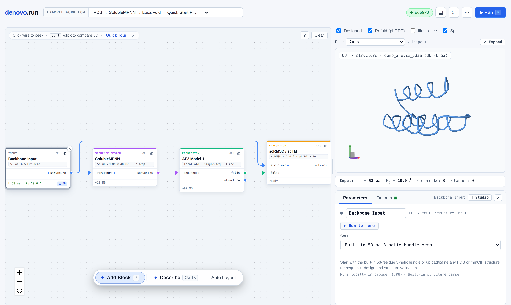

# ProteinDesignSpace (`denovo.run`)

**A browser-native WebGPU node-graph workbench for *de novo* protein design, inverse folding, structure prediction, and biophysical evaluation.**

Run generative, inverse-folding, folding, and scoring models **directly on your local GPU inside the browser via WebGPU** — zero server compute, zero conda environments, zero local installs, and zero sequence/structure uploads (except optional user-confirmed ColabFold MSA lookups).

🌐 **Live Workbench:** [https://denovo.run](https://denovo.run) · 🤗 **WebGPU Weight Mirrors:** [`huggingface.co/ramithuh`](https://huggingface.co/ramithuh) · ⚙️ **Standalone WebGPU Ports:** [`denovo-webgpu-models`](https://github.com/ramithuh/denovo-webgpu-models)

---



*Visual DAG workflow canvas with typed ports, live Mol\* 3D structure viewport, and parameter inspector — running locally on WebGPU.*

---

## Story & Inspiration

When I first started this, I kind of gave up since models at the time weren't great at writing WebGPU kernels. Seeing **Martin Steinegger** and **Sergey Ovchinnikov**'s pioneering WebGPU implementations ([[1]](https://github.com/martin-steinegger/alphafold2-webgpu), [[2]](https://github.com/sokrypton/localfold), [[3]](https://github.com/sokrypton/rfd4-proteina-webgpu)) recently inspired me to pick it back up—and `denovo.run` grew out of that push.

---

## Highlights

- **Visual DAG Workflow Canvas** (`@xyflow/svelte`): Build linear or branched protein design pipelines with typed ports, auto-wiring (`+ Add Block` / `/`), and live intermediate peeking.
- **25 Composable Local WebGPU Blocks** across structure generation, sequence design, structure prediction, property prediction, and 3D evaluation — see [**MODELS_AND_CREDITS.md**](MODELS_AND_CREDITS.md) for the full list of models, licenses, and citations.
- **Natural-Language Workflow Planner**: Describe a pipeline in plain English (`+ Describe`) to draft or edit graphs directly on the canvas.
- **Reproducible & Shareable**: Compact `#p=` / `#g=` URLs, editable YAML/JSON recipes, diffusion trajectory playback, and a multi-round Campaign Inspector.


*See [**MODELS_AND_CREDITS.md**](MODELS_AND_CREDITS.md) for all 25 blocks, upstream weights, licenses, and paper citations.*

---

## Quick Start

```bash
cd web
npm install
npm run dev
```

Open `http://localhost:5173` in a WebGPU-capable browser (Chrome, Edge, Arc, or Firefox 145+ on macOS).

```bash
cd web
npm test              # Vitest unit & upstream integration suite (offline)
npm run check         # svelte-check TypeScript + Svelte diagnostics
npm run build         # Syncs pinned upstreams & builds static SPA -> web/build/
npm run check:deploy  # Verifies required vendor engines & Cloudflare 25 MiB limit
```

Model weights are **never** bundled in `web/build/` — sharded safetensors stream on demand from Hugging Face and cache locally in browser OPFS / CacheStorage. To add a new block to the workbench, see [ADDING_A_METHOD.md](ADDING_A_METHOD.md).

---

## Credits

Huge thanks to **Martin Steinegger** ([`alphafold2-webgpu`](https://github.com/martin-steinegger/alphafold2-webgpu)) and **Sergey Ovchinnikov** ([`localfold`](https://github.com/sokrypton/localfold), [`rfd4-proteina-webgpu`](https://github.com/sokrypton/rfd4-proteina-webgpu)) for pioneering browser-native WebGPU protein models, to the **Ben Murrell Lab** ([`webProteinMPNN`](https://github.com/MurrellGroup/webProteinMPNN)), and to all the open-source protein science authors whose models power this workbench.

For the full table of models, upstream repositories, licenses, and paper citations, see [**MODELS_AND_CREDITS.md**](MODELS_AND_CREDITS.md).

---

## License

The **ProteinDesignSpace (`denovo.run`)** workbench code is licensed under the [MIT License](LICENSE) — *and unofficially under the Ice-Cream-Ware License: if we meet someday and `denovo.run` saved you a conda install or helped design a protein, you can buy me an ice cream in return 🍦*

Vendored third-party inference engines under `web/static/vendor/` (such as LocalFold under Beer-Ware, FoldFlow 2 under CC BY-NC 4.0, and NVIDIA Research components) and model weights downloaded at runtime are **not** covered by this license and remain subject to their respective upstream licenses.
