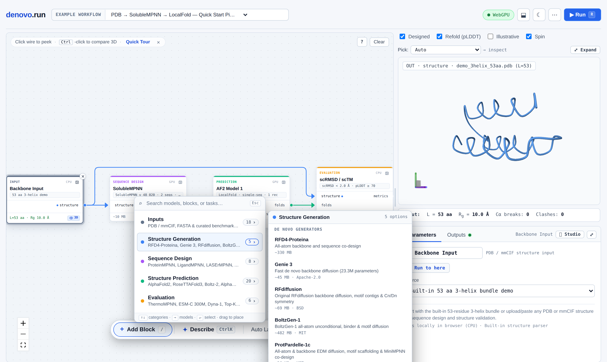

# ProteinDesignSpace (`denovo.run`)

**A browser-native WebGPU node-graph workbench for *de novo* protein design, inverse folding, structure prediction, and biophysical evaluation.**

Run state-of-the-art generative, inverse-folding, folding, and scoring models **directly on your local GPU inside the browser via WebGPU** — zero server compute, zero conda environments, zero local installs, and zero sequence/structure uploads (except optional user-confirmed ColabFold MSA lookups).

🌐 **Live Workbench:** [https://denovo.run](https://denovo.run) · 🤗 **WebGPU Weight Mirrors:** [`huggingface.co/ramithuh`](https://huggingface.co/ramithuh) · ⚙️ **Standalone WebGPU Ports:** [`denovo-webgpu-models`](https://github.com/ramithuh/denovo-webgpu-models)

---


*Visual DAG workflow canvas with typed color-coded ports, live Mol\* 3D structure viewport, and parameter inspector — running locally on WebGPU.*

---

## Highlights

- **Visual DAG Workflow Canvas** (`@xyflow/svelte`): Compose linear or branched protein design pipelines (e.g., comparing **AlphaFold 3 vs AlphaFold 2 vs RoseTTAFold 3**, or **SolubleMPNN vs LigandMPNN vs AntiFold** on a shared backbone), with typed color-coded ports, smart auto-wiring (`+ Add Block` / `/`), resizable split panes, and automatic layout.
- **19 Composable Blocks Across 5 Stages** — all neural inference executes in sequential, VRAM-isolated Dedicated Web Workers with OPFS / CacheStorage weight persistence:
  - **Structure Generation**: **RFD4-Proteina**, **Genie 3**, **RFdiffusion (Base)**, **BoltzGen-1**, and **ProtPardelle-1c**.
  - **Sequence Design**: **ProteinMPNN / SolubleMPNN / Cα-MPNN**, **LigandMPNN**, **LASErMPNN**, **AntiFold & ESM-IF1**, and **EvoDiff-Seq (OA-DM 38M)**.
  - **Structure Prediction** (via LocalFold): **AlphaFold 2** (Monomer & Multimer v3), **AlphaFold 3**, **Boltz-2**, **RoseTTAFold 3**, **Protenix v2**, **OpenFold 3**, **IntelliFold 2**, **OpenDDE**, **Mol1**, and **ESMFold2** (300M & 600M fast single-sequence).
  - **Biophysical Evaluation & 3D Comparison**: **ThermoMPNN** (full L×20 site-saturation ΔΔG stability scan & B-factor painting), **ESM-C 300M** (zero-shot L×20 LLR fitness & naturalness), **Dyna-1** (millisecond conformational exchange), **Top-K Filter**, **Designability Scorer** (exact Kabsch SVD `scRMSD`, `scTM`, Motif RMSD, pLDDT, ipSAE), and **3D Superpose / Compare** (multi-model up to 6-way Kabsch & motif overlay).
- **Natural-Language Workflow Planner**: Describe a pipeline in plain English (`+ Describe`) to draft or edit multi-block graphs directly on the canvas.
- **Shareable Links & Reproducible Recipes**: Compact `#p=` / `#g=` deflate-raw URLs, editable YAML/JSON workflow recipes, live intermediate peeking, diffusion trajectory playback, and a multi-round Campaign Inspector.



*Browse all 19 blocks and model presets by stage from `+ Add Block` or `/`.*

---

## Included Models & Browser Engines

| Stage | Model | Capabilities | Weights / Port | Upstream License |
| --- | --- | --- | --- | --- |
| **Generation** | **RFD4-Proteina** | All-atom sequence-structure co-design, motif, binder, partial diffusion | [`sokrypton/rfd4-proteina-webgpu`](https://github.com/sokrypton/rfd4-proteina-webgpu) · [`nvidia/RFD4-Proteina`](https://huggingface.co/nvidia/RFD4-Proteina) | NVIDIA Open / MIT |
| **Generation** | **Genie 3** | Fast 23.3M SE(3) DDIM backbone diffusion + SequenceNet | [`ramithuh/genie3-webgpu`](https://huggingface.co/ramithuh/genie3-webgpu) | Apache-2.0 |
| **Generation** | **RFdiffusion (Base)** | Original SE(3) backbone diffusion, motif contigs, Cn/Dn symmetry | [`ramithuh/rfdiffusion-webgpu`](https://huggingface.co/ramithuh/rfdiffusion-webgpu) | BSD |
| **Generation** | **BoltzGen-1** | All-atom unconditional, binder & motif diffusion (`diverse`, `adherence`) | [`ramithuh/boltzgen-webgpu`](https://huggingface.co/ramithuh/boltzgen-webgpu) | MIT |
| **Generation** | **ProtPardelle-1c** | All-atom & backbone EDM diffusion, tip-atom motif, MiniMPNN co-design | [`ramithuh/protpardelle-webgpu`](https://huggingface.co/ramithuh/protpardelle-webgpu) | MIT / CC-BY-4.0 |
| **Sequence** | **ProteinMPNN / SolubleMPNN / Cα** | Backbone-conditioned inverse folding (ONNX WebGPU / WASM) | [`MurrellGroup/webProteinMPNN`](https://github.com/MurrellGroup/webProteinMPNN) | MIT |
| **Sequence** | **LigandMPNN** | Ligand-, metal- & nucleic-acid-aware sequence design | [`ramithuh/ligandmpnn-webgpu`](https://huggingface.co/ramithuh/ligandmpnn-webgpu) | MIT |
| **Sequence** | **LASErMPNN** | Ligand-aware sequence & all-atom sidechain rotamer co-design | [`ramithuh/lasermpnn-webgpu`](https://huggingface.co/ramithuh/lasermpnn-webgpu) | MIT |
| **Sequence** | **AntiFold & ESM-IF1** | Antibody CDR inverse folding & GVP-Transformer inverse folding | [`ramithuh/antifold-esmif1-webgpu`](https://huggingface.co/ramithuh/antifold-esmif1-webgpu) | BSD-3 / MIT |
| **Sequence** | **EvoDiff-Seq (38M)** | MSA-free order-agnostic discrete sequence diffusion & inpainting | [`ramithuh/evodiff-webgpu`](https://huggingface.co/ramithuh/evodiff-webgpu) | MIT / CC-BY-4.0 |
| **Prediction** | **LocalFold Suite** | AF2, AF2-Multimer, AF3*, Boltz-2, RF3, Protenix-v2, OpenFold 3, IntelliFold 2, ESMFold2 | [`sokrypton/localfold`](https://github.com/sokrypton/localfold) | Apache-2.0 / MIT / CC-BY-4.0 (*AF3 non-commercial) |
| **Evaluation** | **ThermoMPNN** | Full L×20 site-saturation ΔΔG stability scan & 3D B-factor painting | [`ramithuh/thermompnn-webgpu`](https://huggingface.co/ramithuh/thermompnn-webgpu) | MIT |
| **Evaluation** | **ESM-C 300M** | Zero-shot L×20 LLR fitness heatmap, pseudo-perplexity & masked fill | [`ramithuh/esmc-webgpu`](https://huggingface.co/ramithuh/esmc-webgpu) | MIT |
| **Evaluation** | **Dyna-1** | Millisecond conformational exchange & flexibility prediction | [`ramithuh/dyna1-webgpu`](https://huggingface.co/ramithuh/dyna1-webgpu) | MIT / ESM-3 Open |
| **Evaluation** | **Designability / 3D Compare** | Kabsch SVD `scRMSD`, `scTM`, ipSAE, multi-model & motif 3D superposition | Built-in CPU | MIT |

---

## Quick Start

```bash
cd web
npm install
npm run dev
```

Open `http://localhost:5173` in a WebGPU-capable browser (Chrome, Edge, Arc, or Firefox 145+ on macOS).

### Tests & Production Build

```bash
cd web
npm test              # Vitest unit & upstream integration suite (offline)
npm run check         # svelte-check TypeScript + Svelte diagnostics
npm run build         # Syncs pinned upstreams & builds static SPA -> web/build/
npm run check:deploy  # Verifies required vendor engines & Cloudflare 25 MiB limit
```

### Deploying to Cloudflare Pages

Connect this repository in **Cloudflare Dashboard → Workers & Pages → Create → Pages → Connect to Git**:

| Setting | Value |
| --- | --- |
| **Production branch** | `main` |
| **Root directory** | `web` |
| **Build command** | `npm run build && npm run check:deploy` |
| **Build output directory** | `build` |
| **Node.js version** | `22` (via `web/.node-version`) |

Model weights are **never** bundled in `web/build/` — sharded safetensors stream on demand from Hugging Face and cache locally in browser OPFS / CacheStorage.

---

## Credits, Upstream Repositories & Citations

`denovo.run` stands on the shoulders of extraordinary open-source protein science and WebGPU engineering work. Please cite the original authors and upstream tools when using any model from this workbench:

### Core Browser WebGPU Engines
- **LocalFold & RFD4-Proteina WebGPU** — Sergey Ovchinnikov et al.: [`sokrypton/localfold`](https://github.com/sokrypton/localfold) · [`sokrypton/rfd4-proteina-webgpu`](https://github.com/sokrypton/rfd4-proteina-webgpu)
- **webProteinMPNN** — Ben Murrell Lab: [`MurrellGroup/webProteinMPNN`](https://github.com/MurrellGroup/webProteinMPNN)

### Generative, Inverse-Folding, Folding & Evaluation Models
- **RFdiffusion** — Watson et al. (2023), *De novo design of protein structure and function with RFdiffusion*, Nature 620, 1089–1100 · [`RosettaCommons/RFdiffusion`](https://github.com/RosettaCommons/RFdiffusion)
- **Genie 3** — Lin et al. (2026), *Fast and Ultra-Capable Protein Design: Advancing the Frontier Through Atomistic SE(3)-Equivariance with Genie 3*, bioRxiv · [`aqlaboratory/genie3`](https://github.com/aqlaboratory/genie3)
- **BoltzGen** — Stärk et al. (2025), *BoltzGen: Toward Universal Binder Design* · [`HannesStark/boltzgen`](https://github.com/HannesStark/boltzgen)
- **ProtPardelle-1c** — Chu et al. (2024), *An all-atom protein generative model*, PNAS · [`ProteinDesignLab/protpardelle-1c`](https://github.com/ProteinDesignLab/protpardelle-1c)
- **EvoDiff** — Alamdari et al. (2023), *Protein generation with evolutionary diffusion: sequence is all you need*, bioRxiv · [`microsoft/evodiff`](https://github.com/microsoft/evodiff)
- **ProteinMPNN & SolubleMPNN** — Dauparas et al. (2022), *Robust deep learning–based protein sequence design using ProteinMPNN*, Science · [`dauparas/ProteinMPNN`](https://github.com/dauparas/ProteinMPNN)
- **LigandMPNN** — Dauparas et al. (2025), *Atomic context-conditioned protein sequence design using LigandMPNN*, Nature Methods · [`dauparas/LigandMPNN`](https://github.com/dauparas/LigandMPNN)
- **LASErMPNN** — Polizzi Lab · [`polizzilab/LASErMPNN`](https://github.com/polizzilab/LASErMPNN)
- **AntiFold & ESM-IF1** — Høie et al. (2024), *AntiFold: Improved antibody structure-based design using inverse folding*, Bioinformatics · [`oxpig/AntiFold`](https://github.com/oxpig/AntiFold); Hsu et al. (2022), *Learning inverse folding from millions of predicted structures*, ICML · [`facebookresearch/esm`](https://github.com/facebookresearch/esm)
- **ThermoMPNN** — Dieckhaus et al. (2024), *Transfer learning to leverage larger datasets for improving prediction of protein stability changes*, PNAS · [`Kuhlman-Lab/ThermoMPNN`](https://github.com/Kuhlman-Lab/ThermoMPNN)
- **ESM-C & ESM-3** — EvolutionaryScale / Chan Zuckerberg Biohub · [`Biohub/esm`](https://github.com/Biohub/esm)
- **Dyna-1** — Wayment-Steele et al. (2026), *Learning millisecond protein dynamics from what is missing in NMR spectra*, Nature · [`WaymentSteeleLab/Dyna-1`](https://github.com/WaymentSteeleLab/Dyna-1)
- **Structure Predictors (via LocalFold)** — AlphaFold 2 & 3 (Google DeepMind), Boltz-2 (MIT / Recursion), RoseTTAFold 3 (IPD), Protenix (ByteDance), OpenFold 3 (OpenFold Consortium), IntelliFold 2, ESMFold2.
- **Optional MSA Server** — MMseqs2 / ColabFold API (Mirdita et al., 2022, *ColabFold: making protein folding accessible to all*, Nature Methods) — disabled by default and only used after explicit user confirmation.

### Frontend & Visualization Infrastructure
- [**Mol\***](https://molstar.org/) (3D molecular viewer) · [**XYFlow (`@xyflow/svelte`)**](https://svelteflow.dev/) (visual node-graph canvas) · [**SvelteKit 5**](https://svelte.dev/) · [**ONNX Runtime Web**](https://onnxruntime.ai/)

---

## Repository Layout

```text
ProteinDesignSpace/
├── assets/                     # README screenshots
├── tools/
│   ├── sync-upstream.mjs       # Pinned sparse sync of vendored JS/WGSL runtimes
│   ├── sync-ort-wasm.mjs       # Same-origin ONNX Runtime WASM sync
│   └── check-deploy.mjs        # Verifies vendor engines & Cloudflare 25 MiB cap
└── web/                        # SvelteKit 5 + TypeScript static SPA
    ├── src/lib/
    │   ├── engine/             # Scheduler, registry, catalog, model cards, planner, OPFS cache
    │   ├── protein-ops/        # PDB/mmCIF parser, Kabsch SVD, ipSAE, B-factor painting
    │   ├── workers/            # Dedicated VRAM-isolated WebGPU/CPU workers
    │   ├── ui/                 # Canvas, block catalog, node inspector, peek & campaign UI
    │   ├── viewer/             # Headless Mol* superposition viewer & PAE/mutation heatmaps
    │   └── __tests__/          # Vitest unit & integration suite (368 tests)
    └── static/vendor/          # Vendored zero-dep upstream JS/WGSL modules
```
